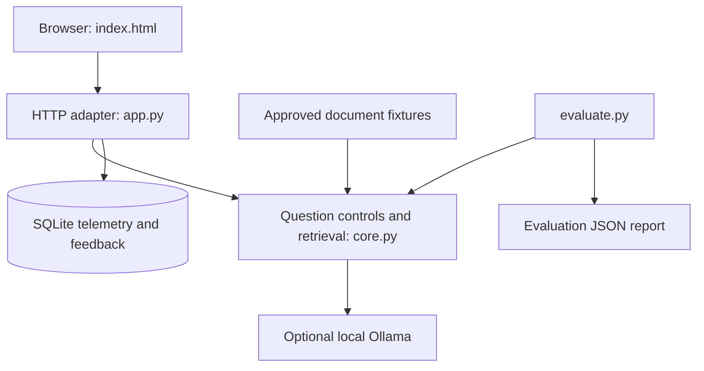

# Architecture

[Documentation index](README.md)

## Components

The browser uses a same-origin JSON API. The HTTP adapter calls the retrieval/control pipeline, then stores minimal telemetry in SQLite. Offline mode remains usable without the model service.

## Ask-request lifecycle

1. Validate the question, simulated role and response mode.
2. Apply instruction-override patterns first, then operational-request patterns. Matched questions return a control status without retrieval.
3. Load document JSON and filter by current, approved and selected role.
4. Normalize title/body/query tokens, compute role-specific BM25 and retain sources meeting query coverage.
5. If no source qualifies, abstain. Otherwise return excerpts or request local-model synthesis.
6. Build the response with status, sources, coverage and local elapsed latency.
7. Persist role/status/mode/latency, assign an answer ID and return JSON. Feedback later refers to this ID.

The response body is not stored in SQLite. The evaluator calls `answer_question` directly and therefore does not generate application telemetry.

## Files and responsibilities

| Path | Responsibility |
|---|---|
| `app.py` | CLI, synchronous localhost server, JSON routes |
| `core.py` | Tokenization, eligibility, BM25, controls, generation adapter, telemetry |
| `index.html` | Question form, source display, feedback and monitoring |
| `data/documents.json` | Eight fictional source fixtures |
| `data/evaluation.json` | Thirty expected question/status/source fixtures |
| `evaluate.py` | Offline fixture evaluation and failure reporting |
| `tests/test_core.py` | Retrieval/control/persistence and provider-failure tests |
| `tests/test_http.py` | Real localhost answer/feedback/error requests |
| `reports/` | Baseline results and validation scope |
| `docs/` | Technical and analyst guides |

## Runtime and performance limits

`HTTPServer` is single-threaded. A local-model request can wait up to its configured 90-second network timeout and block other requests. The corpus is loaded and tokenized for each retrieval; there is no embedding index, chunk store, cache, async job queue or model-session memory. Sources are complete fixture documents rather than parsed PDFs or SharePoint files.

SQLite connections are created per API request and closed afterward. Tables are created if missing; there is no schema migration framework. Query IDs represent requests, not sessions or unique people. The selected role is supplied by the caller and is not an authenticated principal.

See [Retrieval design](retrieval-design.md), [Data dictionary](data-dictionary.md), [API reference](api-reference.md) and [Local LLM](local-llm.md).
