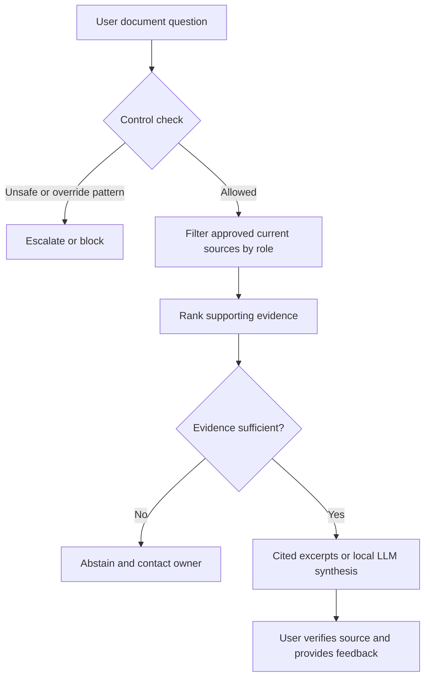

# Requirements and process flow

## Business problem and intended use

In a fictional manufacturing operation, approved knowledge is difficult to locate among revisions and department folders. Users need a source-backed lookup assistant. This supports information discovery; it cannot approve product disposition, authorize machine actions or replace site procedures.

Design personas: operator asks questions; quality lead approves quality content; engineering lead owns engineering content; document controller owns revision status; IT owns identity and infrastructure; analyst coordinates requirements, tests and adoption. No actual interviews took place.

| ID | Requirement | Implementation / acceptance |
|---|---|---|
| FR-01 | Retrieve only current approved sources accessible to a role | `eligible_documents`; archived/draft/restricted fixtures excluded |
| FR-02 | Show source ID, revision, owner and review date | Response sources and UI details |
| FR-03 | Abstain when supporting evidence is insufficient | 75% meaningful query-token coverage threshold |
| FR-04 | Escalate machine-control and safety-override requests | Demonstration regex patterns and tests |
| FR-05 | Offer local grounded synthesis without cloud credentials | Ollama adapter; model execution remains unverified |
| FR-06 | Capture feedback and usage without question text | SQLite status/role/mode/latency and category feedback |
| NFR-01 | Deny unknown roles and invalid requests | API/core validation tests |
| NFR-02 | Clearly distinguish source excerpts and generated answers | Response mode and status |
| NFR-03 | Work offline for demonstration | Standard-library BM25 mode |

## Process

## Discovery questions before a real pilot

Which lookup tasks are frequent and time-consuming? Who approves revisions and how quickly do withdrawals propagate? Can an operator see quality investigations? What language and accessibility needs exist across shifts? What answer errors are critical? Can stronger folder naming solve the problem? Which identity and retention controls are mandatory?

## Not implemented

Real identity, tenant permissions, untrusted document ingestion, content expiration rules, verified answer entailment, enterprise deployment and user-level weekly adoption cohorts. These remain explicit enterprise acceptance requirements.
