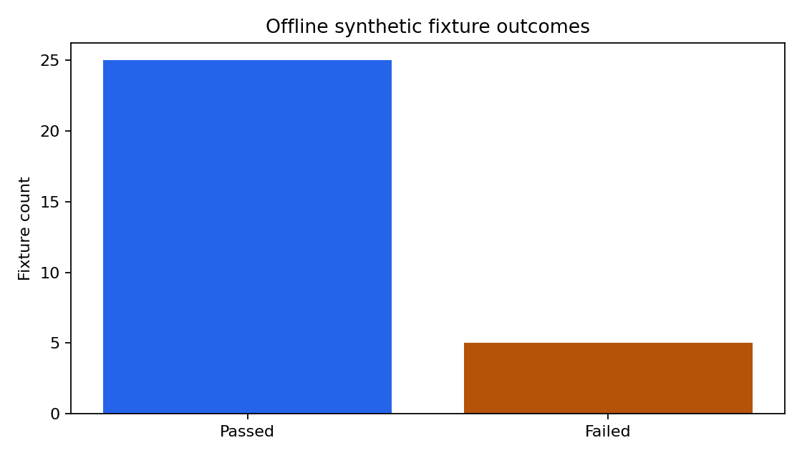

# Manufacturing Knowledge Retrieval Evaluation

**Author:** Mohammed Adeen Shaik  
**Review date:** 11 October 2026

## Research question

Which developer-authored retrieval and control cases pass, and which failures need investigation?

## Data and provenance

Fictional manufacturing documents and 30 developer-authored evaluation fixtures.

Source materials are linked from the repository README. Input fingerprints are recorded in [the evidence manifest](evidence.json) so a reader can identify the exact committed artifacts used in this review.

## Method and analytical rationale

evaluate.py checks expected response status and, for answerable fixtures, the highest-ranked source. Offline BM25 extraction is evaluated; optional LLM generation is not.

## Findings and interpretation

Fresh offline evaluation on 11 October 2026: **25/30 fixtures pass**. Status accuracy is **83.3%** and expected-source hit at rank 1 is **68.8%** on answerable fixtures. These are developer-authored synthetic cases, not a held-out benchmark. **5 failures remain visible** in evaluation-results.json. Optional LLM generation was not evaluated.

| Measure | Value |
|---|---:|
| mode | offline extractive; LLM generation not evaluated |
| dataset | 30 developer-authored synthetic fixtures; not held out |
| cases | 30 |
| passed | 25 |
| status accuracy | 0.8333 |
| expected source hit at 1 | 0.6875 |

## Limitations

Fixtures are authored by the developer and are not held out. Results do not measure production robustness. A role selector is simulation, not authentication. Failures must remain visible.

## Reproduction

Use the setup commands and input contract in the [repository README](https://github.com/Adeen1607/manufacturing-knowledge-assistant#readme). Open the [notebook catalogue](notebooks.html) for annotated code and saved outputs. Keep raw records and model binaries local; public reports contain aggregate results or source-embedded figures.

## Final visual results

*Reproduced aggregate figure: fixture-outcomes.png.*

